```text
anitikrish-ai@github ~ $ contributions
```

<p align="center">
  
</p>

```text
anitikrish-ai@github ~ $ whoami
```

<p align="center">
  
</p>

<p align="center">
  
</p>

```text
anitikrish-ai@github ~ $ ls repos
```

- [ikis-paint-web](https://github.com/anitikrish-ai/ikis-paint-web) - browser drawing app inspired by ibis Paint
- [GlassAnime](https://github.com/anitikrish-ai/GlassAnime) - responsive anime viewing web app (TypeScript)
- [Video-Downloader-](https://github.com/anitikrish-ai/Video-Downloader-) - YouTube video and audio downloader (Flask, yt-dlp)
- [AppHub](https://github.com/anitikrish-ai/AppHub) - desktop and developer software store (Next.js, Supabase)
- [Smexstore](https://github.com/anitikrish-ai/Smexstore) - gaming tournament and game ID marketplace front end (React, TypeScript, Vite)
- [drift-doc](https://github.com/anitikrish-ai/drift-doc) - docs site for DriftJS, a bytecode-VM UI framework
- [dropfast](https://github.com/anitikrish-ai/dropfast) - TypeScript project
